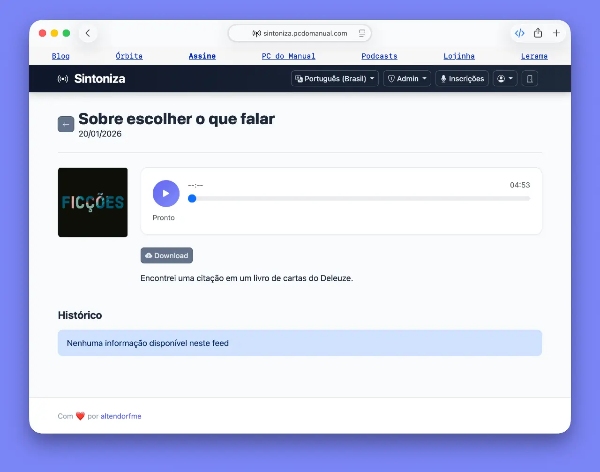

O [Sintoniza](https://sintoniza.pcdomanual.com/) nasceu para sanar uma dor específica: viabilizar a sincronização de podcasts em aplicativos que carecem desse recurso, como o (ótimo) Antennapod.

Na última grande atualização do projeto — criado e mantido pelo [Renan Altendorf](https://altendorfme.com), também responsável pelo PC do Manual —, ele transformou o Sintoniza em um tocador de podcasts independente na web.

Isso significa que agora, além de sincronizar suas inscrições, episódios ouvidos e até posição de reprodução, dá para gerenciar seus podcasts e ouvi-los no próprio Sintoniza na web, em qualquer dispositivo.

O Sintoniza é baseado no protocolo [gPodder](https://gpodder.github.io). Estávamos meio frustrados com as opções disponíveis e, disso, veio a ideia de desenvolver um serviço melhor em cima do protocolo. Funciona super bem.

O Sintoniza é um software livre (código-fonte) e a instância do PC do Manual é gratuita para todos. A Helen Fernanda escreveu [um tutorial de como configurá-lo no Antennapod](https://www.meutedio.com/2026/06/antennapod-sincronizar-podcasts.html), um aplicativo de podcasts para Android.